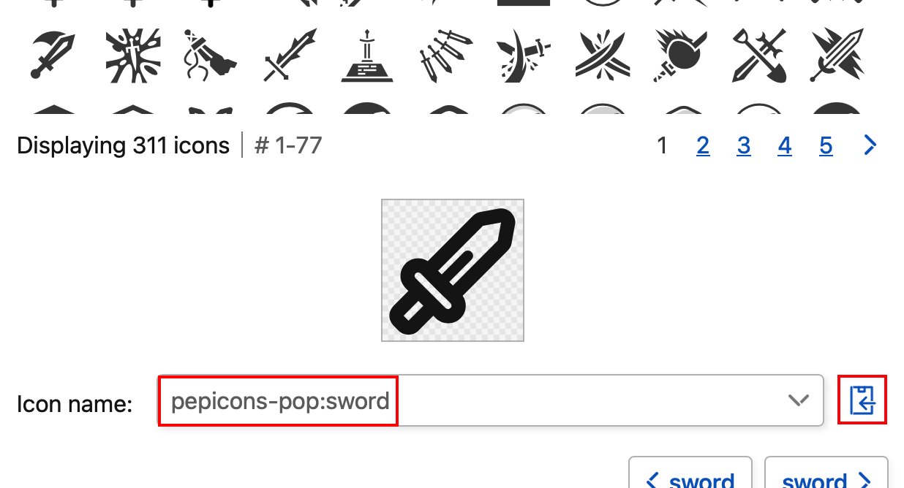

# Informação
A configuração das informações básicas do elemento (ID, nome, explicação, ícone e cor)
- São os campos de informação básica comuns a todos os elementos do mundo (categoria, ação, item, grupo, evento, habilidade e predefinição).
- São definidos separadamente para cada elemento.
___

## ID identificador
O ID único que identifica o elemento
- É o ID que identifica cada elemento de forma única.
- É a cadeia de texto com que o editor distingue esse elemento.
- Por exemplo, qual item é obtido quando uma ação é concluída é indicado pelo ID.
- Os caracteres que podem ser usados são uma combinação de letras, hifens e algarismos, de 1 a 100 caracteres.

!> Depois de distribuir o jogo, não altere um ID já definido. Se alterar, ele deixa de corresponder aos dados de jogo existentes e o jogo para de funcionar corretamente.
___

### O nome que é exibido
O nome de exibição gerado automaticamente a partir do ID
- Quando nenhum nome é definido, os hifens são substituídos por espaços e cada palavra é convertida com a primeira letra em maiúscula e o resto em minúscula, sendo exibida como nome.
- Mesmo que o ID contenha maiúsculas, tudo o que não for a primeira letra é convertido em minúscula.
- Nos idiomas diferentes do inglês é preciso definir o campo de nome separadamente.
___

#### Exemplo
Um exemplo real de conversão de ID
- Se o ID for `stylish-strong-axe`, o nome passa a ser `Stylish Strong Axe`.
- Se o ID for `stylish-STRONG-axe`, também passa a ser `Stylish Strong Axe`.
___

### Não deve se repetir
Proibição de repetir um ID dentro do mesmo tipo
- Como serve para distinguir os elementos, não o repita dentro de cada tipo: categoria, ação, item, grupo, evento, habilidade e predefinição.
- Os eventos tratam tarefas, eventos de mudança e eventos fixos juntos como um único tipo, então também não os repita entre eles.
- Não há problema em o mesmo ID estar em tipos diferentes.
- Um mundo com repetições dá erro na validação.
- [_type_](pt/editor/type)
___

## Nome
O nome do elemento que é exibido
- É o nome do elemento exibido no jogo.
- Também é possível inserir idiomas diferentes do inglês.
- Não há problema em o nome coincidir com o de outro elemento.
- É possível inserir até 20 caracteres.
- Quando não cabe na largura em que é exibido, a parte que ultrapassa é abreviada com `…`.
___

### Conversão automática a partir do ID
A função que gera o nome automaticamente a partir do ID
- Quando deixado em branco, é exibido automaticamente com base no ID. Consulte o item anterior para mais detalhes.
___

## Explicação
A explicação detalhada do elemento
- É a explicação do elemento exibida no jogo.
- Também é possível inserir idiomas diferentes do inglês. Textos longos são exibidos por inteiro.
- Quando não há explicação, deixe em branco.
___

## Ícone
A configuração do ícone que representa o elemento
- Como ícone é possível definir uma imagem, o Iconify ou um emoji.
- O Iconify é um serviço que oferece ícones de vários tipos.
- Se vários deles forem definidos, são exibidos por ordem de prioridade: imagem, Iconify e emoji.
___

### Imagem
Usar qualquer arquivo de imagem
- É a imagem que representa o elemento.
- Ao ser importada, é reduzida automaticamente para no máximo 60×60 pixels e comprimida de novo.
- Não é necessária se você definiu o Iconify ou um emoji.
___

#### Tipos de arquivo
Os formatos de arquivo de imagem compatíveis
- Podem ser usados os formatos comuns que o navegador consegue exibir.
- JPEG, PNG, GIF, WebP, SVG etc.
- GIF e AVIF são convertidos em PNG. JPEG e WebP são reduzidos mantendo o formato original.
- O SVG é incorporado tal como está, sem ser reduzido, então evite os de tamanho grande.
___

### Iconify
Uso dos conjuntos de ícones do Iconify
- É o ícone que representa o elemento.
- Se você definiu uma imagem, ela é exibida com prioridade.
___

#### Como procurar um ícone
Como escolher um ícone no Iconify
- Procure no `Iconify` os ícones que podem ser exibidos.
- Com a busca de ícones você encontra na hora o ícone mais adequado.
- Ao selecionar um ícone, é exibido o identificador desse ícone, como `game-icons:sword-wound` (o tipo de conjunto de ícones `:` o nome do ícone); cole-o tal como está neste campo de ícone.

- [_iconify_](https://icon-sets.iconify.design)
___

### Emoji
Exibir o ícone com um emoji
- Exibe um emoji como ícone.
- Insira o emoji Unicode tal como está.
- Como é usado o emoji instalado no ambiente de execução, a exibição varia um pouco conforme o usuário.
- Com o Iconify é possível definir emojis que não dependem de cada ambiente
- É possível exibir caracteres que não sejam emojis, mas com vários caracteres a exibição pode quebrar.
- Por exemplo, insere-se um emoji como `🗡️` ou `⚔️`.
___

## Cor
A configuração da cor com que o elemento é exibido
- Como cor do elemento, aplica-se ao ícone do elemento e à sua cor de fundo.
- É escolhida no seletor de cores do editor.
- O preto (`#000000`) é tratado como o valor que significa "nenhuma cor definida". O valor inicial do seletor de cores também é esse preto.
- Se quiser que fique preto, indique uma cor levemente deslocada, como `#010101`.
___

### Herança do elemento pai
Como a configuração de cor do elemento pai é herdada
- Ações, itens e eventos sem cor definida herdam a cor da categoria à qual pertencem.
- A hierarquia da herança é a seguinte.
- Nos elementos com uma cor própria definida, essa cor tem prioridade. Não é sobrescrita mesmo que a categoria tenha cor.
- O uso básico é decidir uma cor por categoria e deixar que o que está abaixo herde. A cor individual é definida quando você quer destacar um elemento específico.
- Se um atributo (attribute) estiver definido na ação, a cor herdada não é a da categoria à qual ela pertence, e sim a da categoria indicada no atributo.
- A própria categoria não tem de quem herdar. Se a cor da categoria continuar preta (`#000000`), essa categoria e os elementos abaixo dela sem cor definida são exibidos na cor intermediária entre a cor da barra e a cor do texto do design.
- Grupos, habilidades e predefinições não herdam e usam apenas a cor definida neles mesmos.
```
world (basic.design)
└── category
    ├── action
    ├── item
    └── event
```
- [_type_](pt/editor/type)
___

## Copiar as informações
Duplicar as informações de outro elemento
- Ao pressionar o botão `Copy Information`, as informações de outro elemento são copiadas de uma vez para este elemento.
- Escolha o tipo de origem da cópia (categoria, ação, item, grupo, evento, habilidade ou predefinição) e em seguida insira o ID dele.
- Todos os campos, incluindo o ID identificador, são sobrescritos. Depois de copiar, altere o ID identificador para um que não se repita.
- [_type_](pt/editor/type)